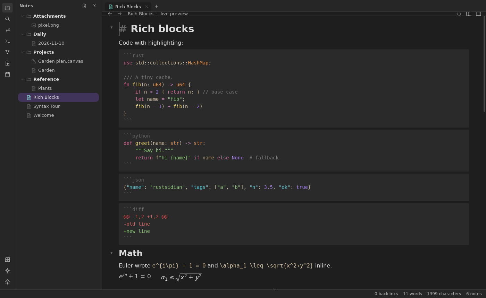
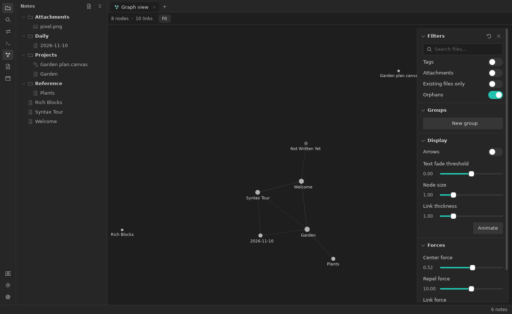
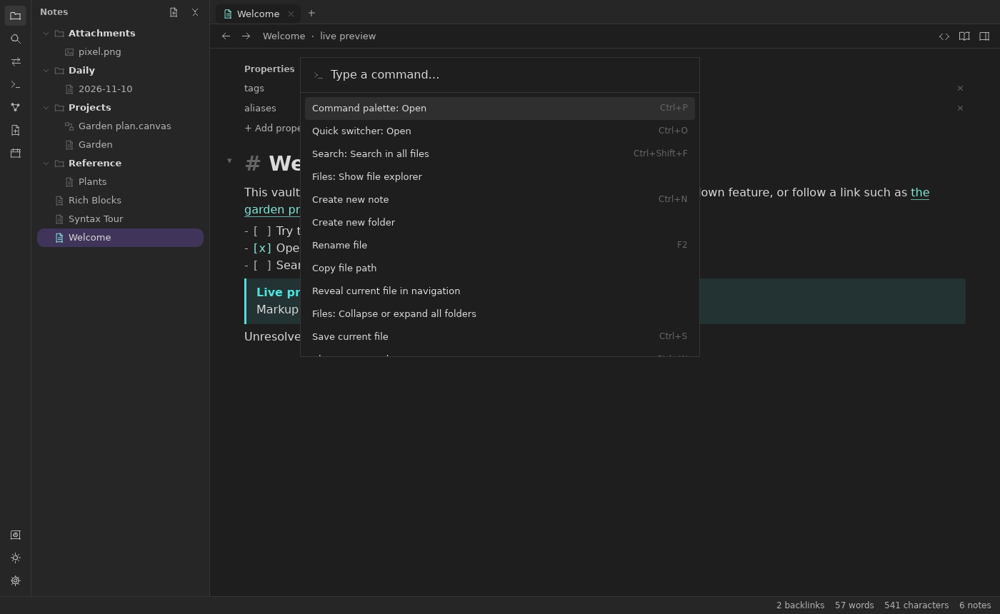
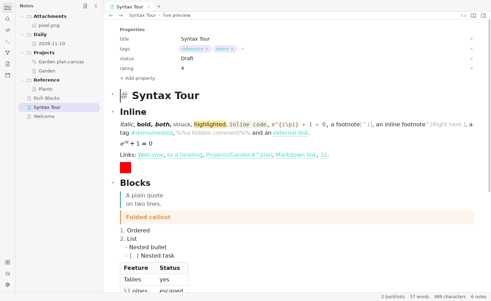
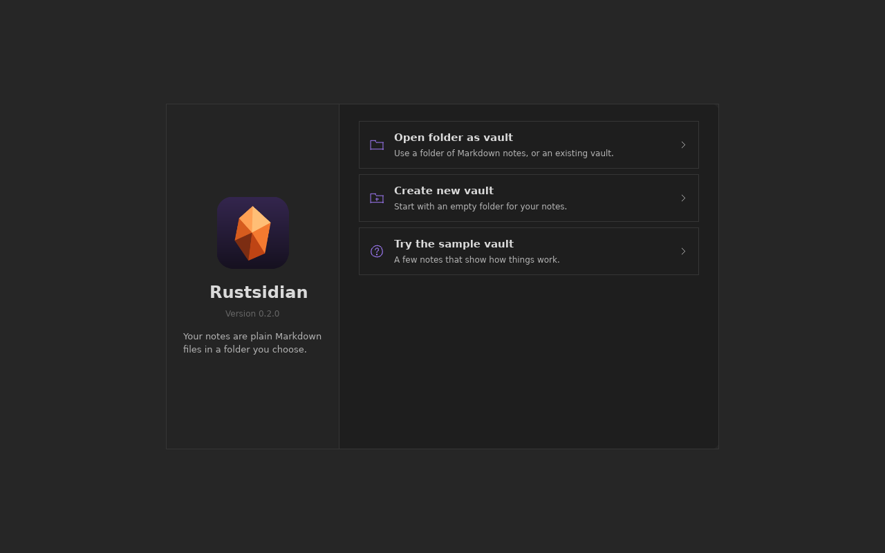

<div align="center">


# Rustsidian

**A fast, native Markdown knowledge base. Plain files, linked thinking, no Electron.**

[](https://github.com/siddarth1872004/RustSidian/actions/workflows/ci.yml)
[](https://github.com/siddarth1872004/RustSidian/releases/latest)
[](#license)


[Download](https://github.com/siddarth1872004/RustSidian/releases/latest) ·
[Website](https://siddarth1872004.github.io/RustSidian/) ·
[Features](FEATURES.md) ·
[Roadmap](ROADMAP.md)



</div>

## Why Rustsidian

- **Your notes stay yours.** A vault is a folder of Markdown files. Open an existing vault as it
  is; Rustsidian keeps its own data in `.rustsidian/` and never rewrites what it does not
  understand.
- **Fast.** A 12 MB native binary with no browser engine inside. It opens 5,000 notes in under
  100 ms, uses about 34 MB of RAM idle at 10,000 notes, and uses no CPU while you're not typing.
- **Linked thinking.** Wikilinks, backlinks, embeds, block references, tags, properties and a
  live graph of how your notes connect.
- **Yours to shape.** CSS themes and snippets, rebindable hotkeys, sandboxed WASM plugins and Rhai
  scripts.

## Highlights

<table>
<tr>
<td width="50%"></td>
<td width="50%"></td>
</tr>
<tr>
<td><b>Graph view</b>: global and local graphs with filters, color groups, display and force
settings, all saved with the vault.</td>
<td><b>Command palette and quick switcher</b>: every action has a stable id and a rebindable
hotkey.</td>
</tr>
<tr>
<td width="50%"></td>
<td width="50%"></td>
</tr>
<tr>
<td><b>Light and dark themes</b>: drop in a community CSS theme or your own snippets; they
reload live.</td>
<td><b>Gentle start</b>: open a folder, create a vault, or explore the sample vault.</td>
</tr>
</table>

| | |
|---|---|
| **Editor** | Live preview, source and reading modes, multi-cursor, undo tree, folding, smart lists, tables, Vim mode, properties editor |
| **Markdown** | CommonMark + GFM, wikilinks, embeds, callouts, footnotes, highlights, math (typeset), Mermaid flowcharts and sequence diagrams, syntax highlighting for 15+ languages |
| **Navigation** | File explorer with right-click menus, tabs, back and forward, outline, backlinks, quick switcher, full-text search with `tag:`, `path:`, `line:`, `[property:value]`, regex and boolean operators |
| **Canvas** | JSON Canvas boards with text, file, link and group nodes, saved without losing anything |
| **Files** | Rename with automatic link updates, atomic saves, conflict detection, trash, daily notes |
| **Extend** | WASM plugins with a permission model, Rhai user scripts, CSS themes and snippets |
| **Export** | HTML and Markdown bundles; a CLI for indexing, search, export and health checks |

[FEATURES.md](FEATURES.md) lists every feature with its status, including what is missing.

## Install

Download the archive for your system from the
[latest release](https://github.com/siddarth1872004/RustSidian/releases/latest) and check it
against `SHA256SUMS.txt`.

| System | Archive | Notes |
|---|---|---|
| Windows 10/11 x64 | `rustsidian-*-windows-x86_64.zip` | Unzip anywhere and run `rustsidian.exe` |
| macOS (Apple silicon / Intel) | `rustsidian-*-macos-arm64.tar.gz` / `macos-x86_64` | Unsigned: right-click → Open the first time |
| Linux x64 | `rustsidian-*-linux-x86_64.tar.gz` | Needs `libxkbcommon-x11` on X11 (`sudo apt install libxkbcommon-x11-0`) and `wl-clipboard`, `xclip` or `xsel` for copy and paste |

On Linux, `packaging/rustsidian.desktop` and `packaging/rustsidian.svg` add a menu entry when
copied to `~/.local/share/applications` and `~/.local/share/icons/hicolor/scalable/apps`.

## Build from source

Requires stable Rust 1.85 or later. Every dependency is pure Rust.

```sh
git clone https://github.com/siddarth1872004/RustSidian && cd RustSidian
cargo build --release -p rustsidian          # target/release/rustsidian
target/release/rustsidian examples/vault     # open the sample vault
target/release/rustsidian help               # CLI: index, search, export, doctor, screenshot
cargo test --workspace                       # 251 tests
```

## Performance

Measured on WSL2 Ubuntu (12 cores, software rendering) with synthetic vaults. The full table and
caveats are in [FEATURES.md](FEATURES.md#performance-budgets).

| | Budget | Measured |
|---|---|---|
| Cold start, 5,000 notes | < 150 ms | 65–98 ms |
| Cold start, 50,000 notes | < 400 ms | 188–260 ms |
| Idle RAM, 10,000 notes | < 80 MB | 34 MB |
| Keystroke to pixels, 1 MB note | < 8 ms | 4.9 ms median, 6.2 ms p95 |
| Quick switcher, 50,000 paths | < 5 ms | 1.8–2.0 ms |
| Full-text search, 50,000 notes | < 30 ms | 14–29 ms (multi-term `line:` queries: 43–51 ms) |

## Project layout

```
crates/md-engine         Markdown parser, incremental re-parse, HTML, front matter
crates/vault-core        index, link resolution, rename, cache, IO, watcher, vault config
crates/search-core       query language, corpus scan, fuzzy matcher
crates/graph-core        graph model, filters, Barnes-Hut layout, graph.json
crates/editor-core       rope buffer, undo tree, commands, folding, decorations, tables, vim
crates/theme-engine      CSS parser, selectors, cascade, values
crates/canvas-core       JSON Canvas model
crates/math-core, mermaid-core, highlight-core   rendering of math, diagrams and code
crates/ext-api           extension API: JSON call boundary, permissions, registry
crates/plugin-host-wasm  sandboxed WASM plugin host
crates/scripting         Rhai user scripts
crates/rustsidian-ui     element tree, flex layout, software renderer
crates/app               shell, commands, view, CLI, window (binary: rustsidian)
```

More documentation: [CUSTOMIZATION.md](CUSTOMIZATION.md) (settings, hotkeys, themes),
[THEME_COMPAT.md](THEME_COMPAT.md) (supported CSS), [PLUGIN_SDK.md](PLUGIN_SDK.md) (WASM
plugins), [DECISIONS.md](DECISIONS.md) (design tradeoffs with measurements),
[PLAN.md](PLAN.md) (per-crate status).

## License

Licensed under either of [MIT](LICENSE-MIT) or [Apache-2.0](LICENSE-APACHE), at your option.
